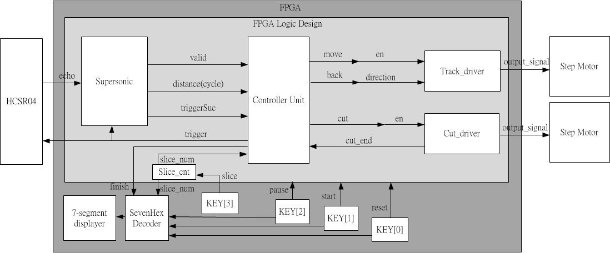

# NTU Digital Circuit Lab: FPGA coursework (DE2-115)

[](https://github.com/EdwinYam/ntu-dclab-fpga/actions/workflows/sim.yml)

Coursework by Bo-Wen Chen with teammates (NTU Digital Circuit Lab, 2017).

These are the labs and final project from the Digital Circuit Lab course in NTU Electrical Engineering, fall 2017. Everything targets the Terasic DE2-115 board (Altera Cyclone IV E, EP4CE115F29C7) and is built with Quartus Prime.

| Part | What it is | Technologies |
|---|---|---|
| [`lab1/`](lab1) | Roll-call random number machine | SystemVerilog, FSM, key debouncing, seven-segment display, cocotb/Python GUI test |
| [`lab2/`](lab2) | RSA-256 decryption core, fed over UART | SystemVerilog, Montgomery multiplication, Qsys, Avalon-MM master, Altera UART (115200 baud) |
| [`lab3/`](lab3) | Audio recorder with variable-speed playback (rebuilt source, see below) | SystemVerilog, I2C, WM8731 codec, I2S, IS61WV102416 SRAM, altpll |
| [`final-kitchens-helper/`](final-kitchens-helper) | Kitchen's Helper: automatic food slicer | Verilog, HC-SR04 ultrasonic ranging, stepper motor drivers, controller FSM |

Each part keeps its RTL, testbenches, the Quartus/Qsys files needed to rebuild it, and the `.sof` bitstream where one survived (Lab 3 and the final project).

## Lab 1: roll-call random number machine

`lab1/src/Top.sv` produces a 4-bit pseudo-random number shown on HEX1..HEX0. KEY0 starts a run and KEY1 resets. Each run steps through 8 numbers, and the hold time grows from 200 ms to 1 s, so the display slows down like a spinning wheel before it stops. Pressing KEY0 again mid-run restarts the sequence.

- `src/DE2_115/`: board top level, key debouncer, hex-to-decimal seven-segment decoder, Quartus project.
- `src/tb_Top.sv`: waveform testbench. Defining `FAST_SIM` scales the delays from milliseconds down to cycles.
- `sim/`: cocotb test with a PyQt seven-segment and push-button GUI. It was written for the course server (Cadence `ius` simulator, PyQt4).

## Lab 2: RSA-256 decryption over UART

`lab2/src/Rsa256Core.sv` computes `a^e mod n` for 256-bit operands:

1. `ModuloProduct` maps the ciphertext into the Montgomery domain (`a * 2^256 mod n`) with a 257-step shift-and-subtract loop.
2. Two `Montgometry` units then run right-to-left square-and-multiply for 256 exponent bits. One unit squares while the other multiplies, so both run in parallel on every iteration. Each Montgomery product is a 256-step add-and-halve loop.

`lab2/src/Rsa256Wrapper.sv` is an Avalon-MM master that polls the Altera UART registers (status, rxdata, txdata). Its `ReadPipeline` collects `n`, `e` and then 32-byte ciphertext blocks one byte at a time. Its `WritePipeline` sends back the 31 plaintext bytes of each block.

- `sys/`: the Qsys system as preserved (clock source, a PLL that divides the 50 MHz clock to 25 MHz, and a 115200-baud UART), plus the generated HDL. The RSA wrapper connects to this system as a custom Avalon-MM master component. Its component definition and the board top level were not preserved.
- `tb/Rsa256Core_tb.sv`: self-checking testbench. It reads ciphertexts from `tb/enctpt.txt` and checks `a^3 mod 33` against a golden value.

## Lab 3: audio recorder

> The original Lab 3 source was not preserved. The code in `lab3/src` was rebuilt from the course specification, and the original bitstream is kept as `lab3/DE2_115.sof`. The rebuilt source has been simulated (see below). It has not been tested on hardware.

The recorder captures audio from the WM8731 codec into the on-board 1M x 16 SRAM and plays it back at a selectable speed.

| Module | Role |
|---|---|
| `AudioPll.sv` | 12 MHz codec master clock (AUD_XCK) from 50 MHz, using an altpll (x6 / 25) |
| `I2cInitializer.sv` | Writes 11 WM8731 registers over I2C at 100 kHz: reset, line-in mute/volume, headphone volume, analog path (microphone with boost, or line in), digital path, power, interface (master, I2S, 16-bit) and sampling (USB mode, 32 kHz), then sets the interface active. If the codec does not acknowledge a write, it retries that write. |
| `AudRecorder.sv` | I2S deserializer: captures 16-bit left-channel samples from AUD_ADCDAT, timed by AUD_BCLK and AUD_ADCLRCK |
| `AudPlayer.sv` | I2S serializer: drives AUD_DACDAT on BCLK falling edges, timed by AUD_DACLRCK, and sends the same sample to both channels |
| `AudDsp.sv` | Playback engine. Fast mode plays every s-th sample (2x to 8x). Slow mode stretches each sample over s frames (1/2x to 1/8x), either repeating it or linearly interpolating to the next one. |
| `AudioCore.sv` | Key-driven FSM (init / idle / record / record-pause / play / play-pause), the SRAM write sequencer (address and data set up before WE# falls and held after it rises), auto-stop when memory is full or playback ends, and an elapsed-seconds counter |
| `DE2_115/DE2_115.sv` | Board top level: KEY0 records or pauses, KEY1 plays or pauses, KEY2 stops, KEY3 resets. SW[2:0] sets the speed, SW[3] selects fast or slow, and SW[4] turns on interpolation. HEX1..0 show seconds, HEX4 shows the speed factor, and LEDs show the state. |

The codec runs as I2S master, so all audio logic is clocked by AUD_BCLK. The I2C initializer runs on CLOCK_50, and its done flag is synchronized into the BCLK domain.

## Final project: Kitchen's Helper

An automatic food slicer. An HC-SR04 ultrasonic sensor measures where the food is on a track. A track motor moves the food forward, and a cutting stepper motor slices it into a user-selected number of pieces.



| Module | Role |
|---|---|
| `controller.v` | Main FSM: initial trigger and measurement, move, measure, cut, pause, and move back after the last slice. For N slices it cuts N - 1 times, once the measured distance has dropped by another 1/N of the initial length. It keeps measurements at least 50 ms apart (`SPACING_CYCLES`). |
| `supersonic.v` | HC-SR04 driver: 10 µs trigger pulse, echo pulse width measured in clock cycles |
| `track_driver.v` | Track motor: clock divider plus forward / reverse / stop drive patterns, selected by `move` and `back` |
| `cut_driver.v` | Cutting stepper: clock divider plus two-phase full-step sequence; each stroke turns 100 steps (90 degrees) and back, then reports `cut_end` (see the note below) |
| `slice_counter.v` | Number of slices (0, 2, 4, 8, 16), stepped with KEY3; KEY1 starts, KEY2 pauses, KEY0 resets |
| `Debounce.sv`, `SevenHexDecoder.sv` | Key debouncing and display |
| `src/DE2_115/` | Board top level, pin assignments and timing constraints |

The testbenches in `testbench/` are self-checking. The three system-level benches close the loop through behavioural models in `testbench/models/`:

| Model | Role |
|---|---|
| `hcsr04_model.v` | HC-SR04: a trigger of at least 10 µs (500 cycles) starts a measurement; after a short delay, echo stays high for a time proportional to the distance. Short triggers and triggers during a measurement are ignored and counted. |
| `track_model.v` | Food tray: moves 1 mm towards the sensor every N cycles while the forward pattern is applied, away from it for the reverse pattern; clamped at the ends of the track |
| `stepper_decoder.v` | Decodes the cutting motor phases into steps and direction, per stroke |
| `kh_monitor.v` | Checks the trigger width, the spacing between measurements and that the tray stands still while cutting; records where each cut happens |

To keep run times short, the benches override parameters instead of changing the defaults: `SPACING_CYCLES` = 2000 (2.5M on the board), 20-cycle cutter steps (`define_cut_speed` = 0.0004 ms instead of 5 ms), a 10-cycle track driver clock (`define_motor_speed` = 0.0002 ms instead of 1000 ms), and 10 cycles of echo per mm instead of 290. Distances scale by the same factor, so the controller sees the same relative positions.

`cut_driver.v` reverses when its step counter reaches 100, but the step taken on that clock edge still uses the old direction, and the same happens when it raises `cut_end`. Each stroke is therefore 100 steps out and 101 back. When the coils are energised for the next stroke, the rotor snaps one step to the starting phase, so the blade starts every stroke from the same position. It ends one step (0.9 degrees) past that position after the last stroke. The testbenches check for this behaviour, and the driver is unchanged.

## Simulation

`scripts/run_sims.sh` compiles and runs every testbench. It needs Icarus Verilog 12 and Verilator 5, or you can use the container in `scripts/Dockerfile.sim`:

```sh
docker build -t hdl-sim -f scripts/Dockerfile.sim scripts
docker run --rm -v "$PWD":/w -w /w hdl-sim sh scripts/run_sims.sh
```

Results with Icarus Verilog 12.0 and Verilator 5.020:

| Testbench | Simulator | Result |
|---|---|---|
| `lab1/src/tb_Top.sv` | iverilog | Runs to completion (waveform only, no checks) |
| `lab2/tb/Rsa256Core_tb.sv` | iverilog | PASS: 5 of 5 vectors |
| `lab3/tb/tb_I2cInitializer.sv` | iverilog | PASS: 11 register writes in order; an injected NACK is retried |
| `lab3/tb/tb_AudioCore.sv` | Verilator | PASS: record/pause/stop, playback at 1x, 3x, 8x, 1/2x repeat, 1/3x and 1/8x interpolated, pause during playback, stop, auto-stop when memory is full |
| `lab3/src` (whole design) | `verilator --lint-only -Wall` | Clean |
| `final-kitchens-helper/testbench/supersonic_tb.v` | iverilog | PASS: a 65535-cycle echo is measured as 65535 cycles |
| `final-kitchens-helper/testbench/cut_driver_tb.v` | iverilog | PASS: two strokes of 100 steps out and 101 back |
| `final-kitchens-helper/testbench/controller_tb.v` | iverilog | PASS: 2, 4, 8 and 16 slices; N - 1 cuts at the expected positions, tray back at its start, motors stopped; pause and resume; 50 ms spacing (scaled) and 10 µs triggers |
| `final-kitchens-helper/testbench/supersonic_controller_tb.v` | iverilog | PASS: 2, 4 and 8 slices through `supersonic.v` and the HC-SR04 model, same checks |
| `final-kitchens-helper/testbench/Top_tb.v` | iverilog | PASS: 2, 4, 8 and 16 slices through the whole design (slice selection, both motor drivers); also checks every cut stroke and that the tray stands still while cutting |

The same script runs on every push in GitHub Actions (`.github/workflows/sim.yml`).

## Building for the board

Open the Quartus project in `lab1/src/DE2_115/` or `lab3/src/DE2_115/` (Quartus Prime 17.0 or later). For the final project, add the sources in `final-kitchens-helper/src/` to a project using the pin assignments in `final-kitchens-helper/src/DE2_115/DE2_115.qsf`. For Lab 2, open `lab2/sys/DE2_115_qsys.qsys` in Qsys and add the RSA wrapper as an Avalon-MM master component connected to the UART. To program a prebuilt `.sof`, use the Quartus Programmer over USB-Blaster.

## Changes from the original files

- Lab 1: the stray `` `elsif `` in `Top.sv` became `` `else `` so that the file compiles outside Quartus.
- Lab 2: an unresolved merge conflict in `Rsa256Wrapper.sv` was resolved to the 2-bit state encoding. The state registers of both pipelines were widened to 2 bits, because they had been declared 1 bit wide for 3 or 4 states. In the testbench, the reset polarity now matches the core's active-low reset, the timeout was lengthened, and golden-value checks plus test vectors were added.
- Final project: the `cut_driver_tb.v` and `Top_tb.v` testbenches now use the current parameter names (`define_cut_speed`, `define_motor_speed`).
- Final project: the 50 ms measurement spacing in `controller.v` is now the `SPACING_CYCLES` parameter, passed through `Top.v` and `supersonic_controller.v`. Its default (2,500,000 cycles) is the old constant, so the board design is unchanged. The `distance` bus in `supersonic_controller.v` and in two testbenches was declared 32 or 17 bits wide and now matches the 27-bit port.
- Final project: while returning the tray after the last cut, the controller only drove the track backwards during each echo. Between measurements (state `BACK_TRI`, about 50 ms of every cycle) it drove `move` without `back`, so the track motor ran forwards and the tray never came back. `back` is now held for the whole return. The closed-loop testbenches found this.
- Final project: the waveform-only testbenches were rewritten as self-checking benches, with the models in `testbench/models/`.
- Build products, simulator work directories, logs, reports and presentation files were not carried over.
